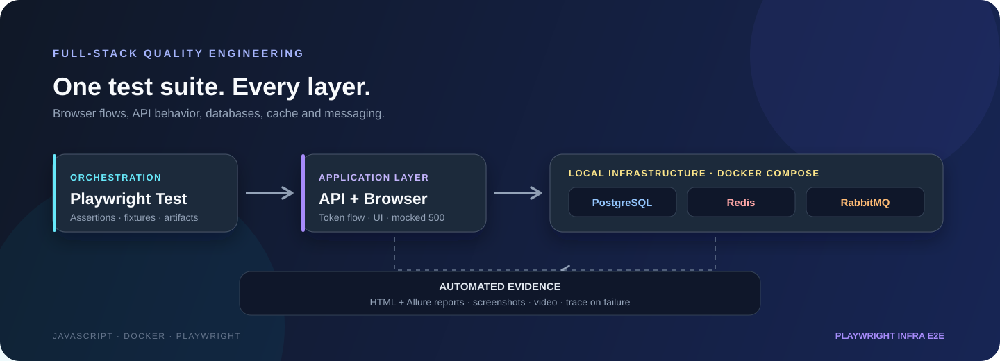

<div align="center">



<h1>Playwright Infra E2E</h1>

<p><strong>One JavaScript test project for browser flows, APIs, databases, cache, and message queues.</strong></p>

<p>
  <a href="https://github.com/microsoft/playwright"></a>
  
  
  
  
  
</p>

<p>
  <a href="#-overview">Overview</a> ·
  <a href="#-test-coverage">Test coverage</a> ·
  <a href="#-quick-start">Quick start</a> ·
  <a href="#-monitoring-and-load-test">Monitoring</a> ·
  <a href="#-reports--debugging-artifacts">Reports</a> ·
  <a href="#-project-structure">Project structure</a>
</p>

<p><a href="#-русская-версия">Русская версия ↓</a></p>

</div>

---

## 🚀 Overview

**Playwright Infra E2E** is a JavaScript automation project that demonstrates how to test beyond the browser. It combines a hybrid API/browser scenario with integration checks for a local PostgreSQL database, Redis cache, and RabbitMQ message broker.

The infrastructure services and the Playwright test runner can run together through Docker Compose. Playwright Test runs the suite in Chromium, while the HTML and Allure reporters provide test results and debugging evidence.

> **Scope note:** PostgreSQL, Redis, and RabbitMQ are standalone services used by this project's integration tests. They are not represented as internal components of the external demo e-commerce application.

## ✨ Test coverage

| Test area | What it verifies |
|---|---|
| **API + browser** | Authenticates against the demo application's API, retrieves a product, creates an order, and cleans it up after the test run. A browser test injects the token before page scripts execute, mocks the order-history API with HTTP `500`, and verifies the response status. |
| **GraphQL** | Queries the SpaceX GraphQL API and verifies the company's name, founder, and CEO. |
| **PostgreSQL** | Creates a test table if needed, inserts a uniquely identified row, reads it back, and checks the returned data. |
| **Redis** | Writes a mock session value to Redis and verifies it can be read back. |
| **RabbitMQ** | Publishes a JSON order message to a queue, consumes it, and checks its fields. |
| **RabbitMQ load test** | Publishes 100 test messages, leaves them available for 15 seconds, then drains the queue. |

The API/browser scenario requires a valid demo-app account, provided through `ECOM_USER_EMAIL` and `ECOM_USER_PASSWORD`. Credentials are not committed to the repository.

GitHub Actions builds and runs the Playwright container with Docker Compose, which starts PostgreSQL, Redis, and RabbitMQ and waits for their health checks. The API/browser scenario is reported as skipped when its credentials are not configured; add `ECOM_USER_EMAIL` and `ECOM_USER_PASSWORD` under **Repository Settings → Secrets and variables → Actions** to enable it in CI.

## 🧱 Technology stack

| Technology | How it is used |
|---|---|
| **Playwright Test** | Test runner, browser automation, API requests, assertions, network interception, and test artifacts |
| **JavaScript (ES Modules)** | Project language and module system |
| **GraphQL API** | SpaceX company information query |
| **PostgreSQL 15 + `pg`** | SQL integration test |
| **Redis 7 + `redis`** | Cache integration test |
| **RabbitMQ 3 + `amqplib`** | AMQP publish/consume integration test |
| **Docker Compose** | Local, repeatable infrastructure setup |
| **Prometheus + Grafana** | RabbitMQ metrics scraping and metrics dashboard service |
| **Elasticsearch + Kibana** | Local search and data exploration services |
| **Kubernetes** | PostgreSQL deployment and integration test through a temporary port-forward |
| **HTML reporter + Allure** | Test reporting |

## 📊 Monitoring and load test

Docker Compose also starts Prometheus, Grafana, Elasticsearch, and Kibana:

| Service | URL |
|---|---|
| Prometheus | [http://localhost:9090](http://localhost:9090) |
| Grafana | [http://localhost:3000](http://localhost:3000) (default local login: `admin` / `admin`) |
| Elasticsearch | [http://localhost:9200](http://localhost:9200) |
| Kibana | [http://localhost:5601](http://localhost:5601) |

Prometheus uses `monitoring/prometheus.yml` to scrape the RabbitMQ metrics endpoint on port `15692`. Run the load-test spec independently with `npx playwright test tests/queue-load-test.spec.js`; RabbitMQ must be running. The test publishes 100 sample messages to its own queue, waits 15 seconds, then drains that queue without interfering with the RabbitMQ integration test.

## 🎬 Reports & debugging artifacts

The Playwright configuration records a **screenshot, video, and trace only when a test fails**. These artifacts can be inspected with Playwright's Trace Viewer.

Run the tests first, then open the reports:

```bash
# Open the Playwright HTML report
npx playwright show-report

# Generate and open the Allure report
npm run allure:generate
npm run allure:open
```

Generated files are kept locally and excluded from Git:

| Artifact | Location |
|---|---|
| Screenshots, videos, traces, and test results | `test-results/` |
| Playwright HTML report | `playwright-report/` |
| Raw Allure results and attachments | `allure-results/` |
| Generated Allure site | `allure-report/` |

The repository does not include fabricated screenshots or sample videos. The actual screenshots and recordings are produced when you run the tests.

## 🚀 Quick start

### Prerequisites

- Node.js LTS and npm
- Docker Desktop (or Docker Engine) with Docker Compose
- A valid account for the demo e-commerce application to run the API/browser test

### 1. Clone and install

```bash
git clone https://github.com/DuishonAbdykerimov/playwright-infra-e2e.git
cd playwright-infra-e2e
npm ci
npx playwright install
```

On Linux CI machines, install the browser system dependencies as well:

```bash
npx playwright install --with-deps
```

### 2. Configure demo-app credentials

Copy the example environment file:

```bash
cp .env.example .env
```

Add your demo-app credentials to `.env`:

```dotenv
ECOM_USER_EMAIL=your-demo-account-email
ECOM_USER_PASSWORD=your-demo-account-password
```

Export the variables into the current shell before running the tests:

```bash
set -a
source .env
set +a
```

`.env` is ignored by Git. Never commit real credentials. The API/browser test is skipped if either variable is missing.

In GitHub Actions, the API/browser test is skipped if its credentials are not configured. To enable it, add repository Actions secrets named `ECOM_USER_EMAIL` and `ECOM_USER_PASSWORD`.

### 3. Run the full project in Docker

```bash
docker compose --profile test run --build --rm e2e
```

Compose builds the Playwright test image, starts PostgreSQL, Redis, and RabbitMQ, waits for their health checks, then runs the suite in Chromium. The Playwright container connects to the infrastructure using Compose service names. The Kubernetes PostgreSQL test is skipped in this container because it has no Kubernetes cluster or `kubectl`; run that test from the host as described below. Test reports and artifacts are saved to the project directory.

The RabbitMQ management console is available at [http://localhost:15672](http://localhost:15672) while the services are running.

> The credentials in `docker-compose.yml` are local development defaults for this disposable test environment. Do not reuse them for a public or production deployment.

### Alternative: run tests on your host

```bash
# Start the infrastructure services
docker compose up -d

# Install dependencies and browsers on the host, then run tests
npm ci
npx playwright install
npm test
```

Run an individual infrastructure test:

```bash
npx playwright test tests/graphql-test.spec.js
npx playwright test tests/db-test.spec.js
npx playwright test tests/redis-test.spec.js
npx playwright test tests/queue-test.spec.js
```

Run the Kubernetes PostgreSQL test after applying its manifest and making sure the Kubernetes cluster is running and selected in the current `kubectl` context. The test starts and stops a temporary port-forward automatically:

```bash
kubectl apply -f k8s/postgres-k8s.yaml
npx playwright test tests/db-k8s-test.spec.js
```

To connect directly to a database at a different address, set `K8S_POSTGRES_HOST` and `K8S_POSTGRES_PORT`; setting the host disables the automatic port-forward.

Run only the API/browser spec:

```bash
npx playwright test tests/e2e-order.spec.js
```

### 5. Stop the local services

```bash
docker compose down
```

To also remove the local PostgreSQL volume and its data, use `docker compose down -v`.

## 📁 Project structure

```text
├── API/                 # API client for the demo e-commerce application
├── database/            # PostgreSQL and Redis clients
├── docs/                # Project architecture illustration
├── monitoring/          # Prometheus scrape configuration
├── pages/               # Page Object Model classes
├── queue/               # RabbitMQ client
├── tests/               # API/browser and infrastructure test specs
├── .env.example         # Environment variable template
├── Dockerfile           # Playwright test-runner image
├── docker-compose.yml   # Test runner and local infrastructure services
└── playwright.config.js # Browser project, reporters, and artifacts
```

## 🇷🇺 Русская версия

### О проекте

**Playwright Infra E2E** — проект на JavaScript для практики автоматизации: он объединяет гибридный API/browser-сценарий и интеграционные проверки PostgreSQL, Redis и RabbitMQ. Локальные сервисы запускаются через Docker Compose. Это отдельная тестовая инфраструктура, а не описание внутреннего устройства demo-магазина.

### Покрытие тестами

| Область | Что проверяется |
|---|---|
| **API + браузер** | API-авторизация, получение товара и создание заказа с последующей очисткой. В браузер заранее передаётся токен, ответ API истории заказов подменяется на HTTP `500`, проверяется статус ответа. |
| **PostgreSQL** | Создание таблицы, запись уникальной строки и проверка чтения данных. |
| **Redis** | Запись mock-значения сессии и чтение его обратно. |
| **RabbitMQ** | Публикация JSON-сообщения, чтение из очереди и проверка полей. |
| **Нагрузочный тест RabbitMQ** | Публикация 100 тестовых сообщений, ожидание 15 секунд и очистка очереди. |

Для API/browser-теста нужны `ECOM_USER_EMAIL` и `ECOM_USER_PASSWORD` — учётные данные demo-приложения. Не сохраняйте их в Git.

### Быстрый запуск

Нужны Node.js LTS, Docker Compose и учётная запись demo-приложения.

```bash
git clone https://github.com/DuishonAbdykerimov/playwright-infra-e2e.git
cd playwright-infra-e2e
npm ci
npx playwright install
cp .env.example .env
```

Добавьте учётные данные в `.env`, затем загрузите переменные в shell и запустите весь проект в Docker:

```bash
set -a
source .env
set +a
docker compose --profile test run --build --rm e2e
```

Команда соберёт контейнер Playwright, запустит PostgreSQL, Redis и RabbitMQ, дождётся их готовности и выполнит тесты. Отчёты сохранятся в папки проекта. Для остановки сервисов используйте `docker compose down`.

### Мониторинг и нагрузочный тест

Docker Compose также запускает Prometheus, Grafana, Elasticsearch и Kibana:

| Сервис | Адрес |
|---|---|
| Prometheus | [http://localhost:9090](http://localhost:9090) |
| Grafana | [http://localhost:3000](http://localhost:3000) (локальный вход по умолчанию: `admin` / `admin`) |
| Elasticsearch | [http://localhost:9200](http://localhost:9200) |
| Kibana | [http://localhost:5601](http://localhost:5601) |

Prometheus использует `monitoring/prometheus.yml` для сбора метрик RabbitMQ через порт `15692`. Нагрузочный тест можно запустить отдельно командой `npx playwright test tests/queue-load-test.spec.js`; для него должен быть запущен RabbitMQ. Тест публикует 100 примеров сообщений в отдельную очередь, ждёт 15 секунд и затем очищает её, не мешая обычному RabbitMQ-тесту.

Если хотите запускать тесты непосредственно на компьютере, сначала поднимите только инфраструктуру:

```bash
docker compose up -d
npm ci
npx playwright install
npm test
```

### Отчёты и артефакты

Playwright записывает скриншот и видео каждого теста, а при падении сохраняет trace. После запуска тестов откройте отчёты:

```bash
npx playwright show-report
npm run allure:generate
npm run allure:open
```

Артефакты создаются локально в `test-results/`, `playwright-report/`, `allure-results/` и `allure-report/` и не коммитятся в репозиторий.

GitHub Actions собирает и запускает Playwright-контейнер через Docker Compose, который также поднимает PostgreSQL, Redis и RabbitMQ. API/browser-тест пропускается, если в настройках Actions не заданы секреты `ECOM_USER_EMAIL` и `ECOM_USER_PASSWORD`.

---

<div align="center">
  <sub>Project author: <strong>Duishon Abdykerimov</strong></sub>
</div>
